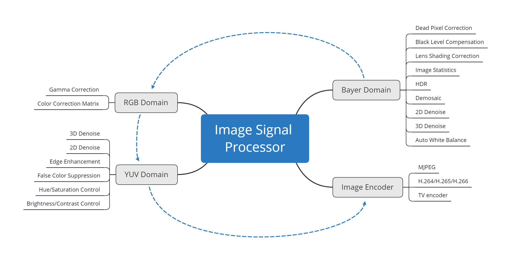
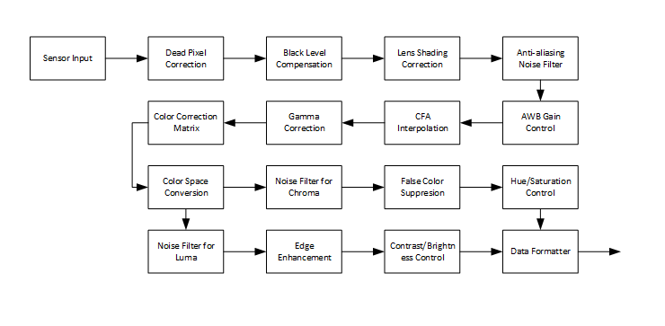
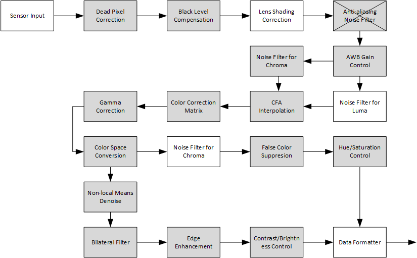

# Open Image Signal Processor (openISP)

## Introduction

Image Signal Processor (ISP) is an application processor to do digital image processing, specifically for conversion from RAW image (acquired from Imaging Sensors) to RGB/YUV image (to further processing or display).


## Objectives

This project aims to provide an overview of ISP and stimulate the whole ISP pipeline and some tuning functions from hardware perspectives. The proposed ISP pipeline consists of following modules, dead pixel correction (DPC), black level compensation (BLC), lens shading correction (LSC), anti-aliasing noise filter (ANF), auto white balance gain control (AWB), color filter array interpolation (CFA), gamma correction (GC), color correction matrix (CCM), color space conversion (CSC), noise filter for luma and chroma (NF), edge enhancement (EE), false color suppression (FCS), hue/saturation/control (HSC) and brightness/contast control (BCC). The ISP pipeline architecture refers from [1], directly captured from book.



Some advanced functions like wide/high dynamic range (W/HDR) and temporal/spatial noise filter (T/SNF) will be implemented in the future.

The new ISP pipeline is modified based on previous one to make the pipeline more reasonable and the ISP performance better.



- [x] Dead Pixel Correction
- [x] Black Level Compensation
- [ ] Lens Shading Correction
- [x] Anti-aliasing Noise Filter
- [x] AWB Gain Control
- [x] Noise Reduction (Bayer Domain)
  - [ ] Luma Denoising
  - [x] Chroma Denoising
- [x] Demosaicing
- [x] Gamma Correction
- [x] Color Correction Matrix
- [x] Color Space Conversion
- [ ] Noise Filter for Luma/Chroma
  - [x] Luma Noise Reduction
    - [x] Bilateral Filtering
    - [x] Non-local Means Denoising
  - [ ] Chroma Noise Reduction
- [x] Edge Enhancement
- [x] False Color Suppression
- [x] Hue/Saturation Control
- [x] Brightness/Contrast Control

## References
[1] Park H.S. (2016) Architectural Analysis of a Baseline ISP Pipeline. In: Kyung CM. (eds) Theory and Applications of Smart Cameras. KAIST Research Series. Springer, Dordrecht.

## File Structure

The openISP project tree structure is listed as follows.

```shell
openISP
│  .gitignore
│  isp_pipeline.py
│  LICENSE
│  README.md
│
├─config
│      config.csv
│
├─docs
│      openISP.md
│
├─hardware
├─images
│      isp_pipeline.png
│      isp_pipeline2.png
│
├─model
│     awb.py
│     bcc.py
│     blc.py
│     bnf.py
│     ccm.py
│     cfa.py
│     cnf.py
│     csc.py
│     dpc.py
│     eeh.py
│     fcs.py
│     gac.py
│     hsc.py
│     nlm.py
│
├─raw
│      test.RAW
│
└─tuning
```

`config` contains config.csv which has all ISP configurable parameters. 

`docs` contains the documentation of ISP, including algorithms introduction and other information. 

`hardware` is remained for the hardware implementation (Verilog/Chisel) of ISP algorithms and SoC.

`images` has all images in *.md files.

`model` is the python implementation of ISP algorithms.

`raw` has *.RAW images of 10/12 bits.

`tuning` is remained for ISP tuning tool, which is in progress.

## Usage

After cloning the repo, just

```python
python isp_pipeline.py
```

It loads `test.raw` image and `config.csv` and executes the algorithms step by step.

You can adjust the ISP pipeline as you want. However, algorithms like DPC, BLC, LSC, ANF, AWB, CFA, only work in Bayer domain. GC, CCM, CSC work in RGB domain. Others work in YUV domain. It's not saying like NF only work in YUV domain. Just in openISP case, it works in YUV domain. Noise filtering could be done in Bayer/RGB/YUV domain and in both temporal/spatial domain.

## Hardware ISP on AMD Kria KV260

A bit-exact hardware implementation of this pipeline in SystemVerilog (no HLS), running on the
KV260 with the onsemi AR1335 sensor (connector J8), with 3A statistics in hardware, a Linux
driver, AE/AWB/AF firmware and a PC tuning tool.

| Part | Location | Status |
|---|---|---|
| Integer golden model (bit-accurate reference, 3A statistics) | `hwmodel/`, `docs/hw/golden_model.md` | done |
| RTL: DPC, BLC, AAF, AWB gain, CNF, CFA, CCM, gamma, CSC, NLM, BNF, EE, FCS/HSC/BCC, 3A statistics; 2 pixels/clock | `hw/rtl/`, `docs/hw/rtl.md` | bit-exact vs the model (Verilator / xsim) |
| Control: shadow registers + frame-boundary commit, IRQ, soft reset, AXI4-Lite (`isp_axil`) | `hw/rtl/top/` | done |
| Block design: CSI-2 RX -> ISP -> YUYV -> frame buffer -> DDR | `hw/kv260/m3_isp/` | on board: 1080p30 and 4K30 at a 200 MHz video clock (timing met) |
| Linux driver (V4L2 sub-device, register / statistics ioctls) | `hw/kv260/driver/` | on board (Kria Ubuntu 22.04, 5.15) |
| Firmware: `openisp` tool, 3A daemon (AE / AWB / CCM / AF), live tuning socket; `oisp_view` zero-copy HDMI/DP preview | `sw/`, `docs/sw.md` | on board: AE/AWB closed loop, 30 fps preview |
| Tuning tool: black level, noise, white balance (white target or ColorChecker), CCM, bit-exact preview, live tuning | `isptune/` | done; AR1335 black level calibrated, colour calibration pending |
| Tests | `tests/` (`python -m pytest tests`) | 127 tests: model, RTL vs model, firmware vs model, tuning |

Bring-up notes, measured AR1335 behaviour and known board issues: `hw/kv260/README.md`.

Open items: colour calibration (CCM) with a ColorChecker, 250 MHz video clock, NV12 output,
lens shading correction.

## License

MIT @Crux